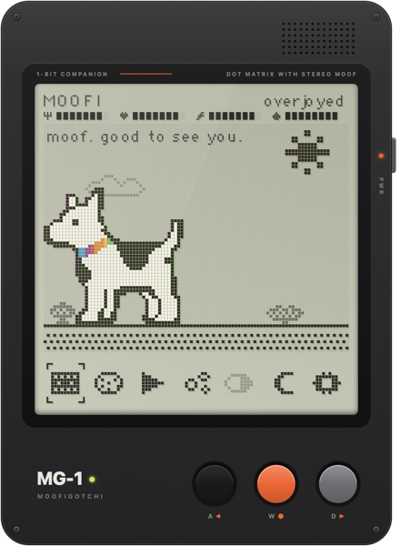
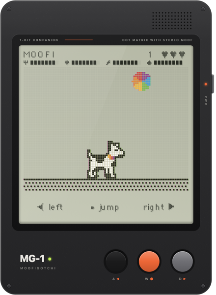
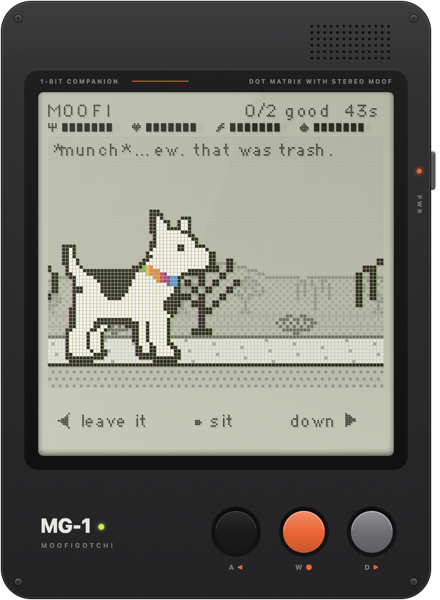
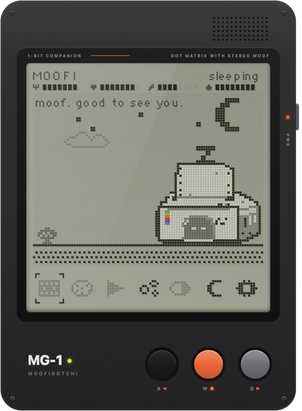
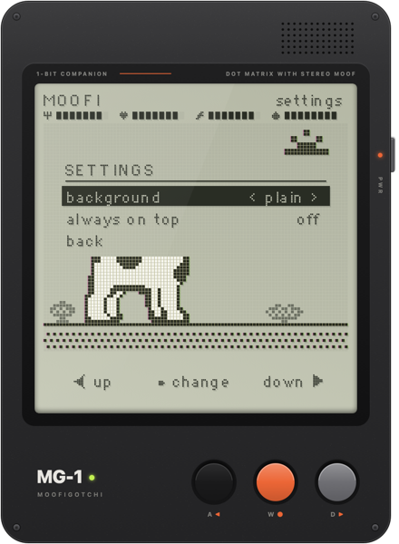
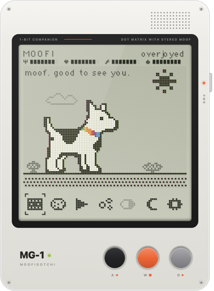

# Moofigotchi · MG-1

A dogcow Tamagotchi as a small piece of hardware for your Mac: a dot-matrix LCD,
three keys and a power button on the side. Follows light/dark mode.

<p>
  
  
  
</p>
<p>
  
  
  
</p>

## Run

Requires macOS and the Swift compiler (Xcode or `xcode-select --install`).

```sh
git clone https://github.com/outoffoffice/moofigotchi.git
cd moofigotchi
./moofigotchi                # start (builds with swiftc on first run)
./moofigotchi --name Clara   # set the name
./moofigotchi --reset        # start over
```

## Controls

| Key            | Button | Function                                |
|----------------|--------|-----------------------------------------|
| `A` / `←`      | ◀      | move selection left                     |
| `W` / `↑` / ⏎  | ●      | select                                  |
| `D` / `→`      | ▶      | move selection right                    |
| `Esc`          |        | back / quit game                        |
| `Space`, click on Moof | | pet                                    |
| `T` / ⌘T       |        | always on top                           |

Icons on the LCD: feed · snack · play · clean · medicine · light · settings.
States: normal, **selected** (corner brackets), **pressed** (inverted), *inactive* (tinted).

**Play →**
- *Beach ball*: keep the spinning ball bouncing on Moof's nose. ◀ ▶ move, ● jump (stronger bounce).
- *Go for a walk*: walk through the panorama. ◀ "leave it!" for trash on the path,
  ● "sit!" at a red light, ▶ "down!" when a cat walks by.

**Sleep**: during the day Moof snoozes on the floor; at night (8 pm–7 am) Moof
goes into the printer house.

**Settings**: background (plain · horizon · rings · grid · waves), always on top.

**Power**: press the button on the right side of the case to switch off.

The save file lives in `~/.moofigotchi.json`. Time keeps passing while Moof is closed.

## License

MIT – see [LICENSE](LICENSE).
